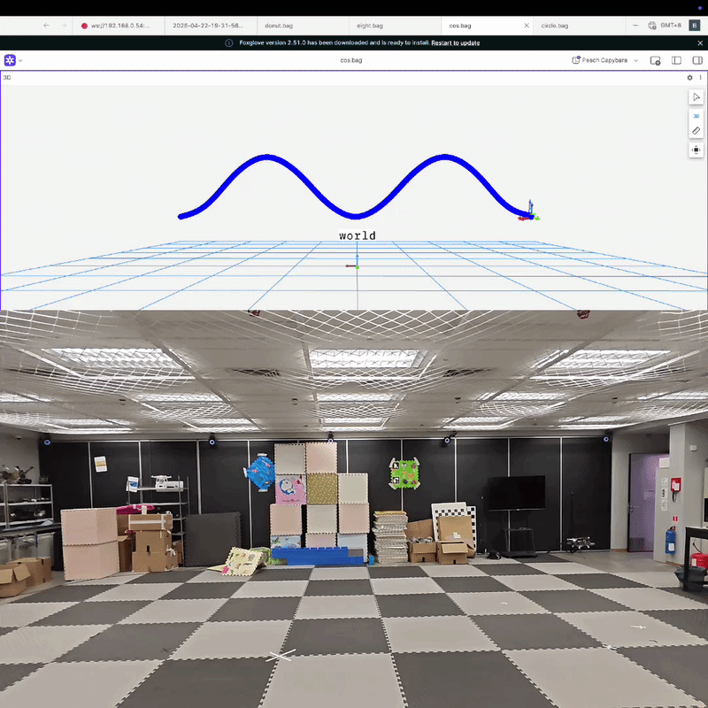

# ELEC 5660 Project 1 Phase 4 Report Template

*Autonomous Flight with OptiTrack: Flight Data Analysis Report*

> Use this template as a concise final report. The assignment requires **one group report of no more than 2 pages** and asks for **analysis of actual flight data**, including at least **position** and **velocity tracking errors**.

## Group Information

- **Group Number:** [Group X]
- **Group Members:** [Name 1; Name 2; Name 3]
- **Experiment Date:** [YYYY-MM-DD]
- **Project Name:** `GroupX-Proj1Phase4`

## 1. Objective and Test Setup

[Briefly state the objective of this phase: autonomous trajectory tracking using OptiTrack feedback, controller verification, and evaluation of trajectory-following performance. Then summarize the setup: drone platform, OptiTrack system, onboard computer, flight area, and recorded data streams.]

## 2. Trajectory Design and Controller Settings

Summarize the provided trajectory and the two additional trajectories you designed. Record any controller parameter tuning you performed and explain why those changes were made.

| Trajectory | Waypoint / Shape Description | Controller Parameters | Observed Performance | Notes |
|---|---|---|---|---|
| Provided | `[(1.0,1.0,-0.3), ... , (0.0,0.0,0.0)]` | [e.g., gains / limits] | [stable / oscillatory / lagging] | [key observation] |
| Custom 1 | [describe the path] | [parameter changes] | [flight outcome] | [design rationale] |
| Custom 2 | [describe the path] | [parameter changes] | [flight outcome] | [design rationale] |

## 3. Flight Data and Quantitative Results

Insert plots or summarized statistics from the actual flight data. At minimum, include **position tracking error analysis** and **velocity tracking error analysis**. You may additionally include acceleration, angular velocity, thrust, or other signals if they help explain performance.

| Metric | Provided Trajectory | Custom 1 | Custom 2 | Comment |
|---|---:|---:|---:|---|
| Position RMSE (m) | [ ] | [ ] | [ ] | [definition / note] |
| Max Position Error (m) | [ ] | [ ] | [ ] | [ ] |
| Velocity RMSE (m/s) | [ ] | [ ] | [ ] | [ ] |
| Peak Velocity Error (m/s) | [ ] | [ ] | [ ] | [ ] |

**Suggested figure placeholders**
- Figure 1. Position tracking result (reference vs. actual).
- Figure 2. Velocity tracking result (reference vs. actual).
- Figure 3. Tracking error over time, or a 3D trajectory comparison.

## 4. Analysis and Discussion

[Interpret the quantitative results. Discuss where the tracking error is small or large, possible causes of error, whether controller tuning improved performance, and the trade-off between aggressive motion and tracking accuracy.]

## 5. Conclusion

[Summarize the main findings in 2-4 sentences. State which trajectory was tracked best, what controller changes were most effective, and what you would improve in future tests.]

## Writing Reminders

- Keep the final report within **2 pages**.
- This is a **group submission**; list all group members clearly.
- Prioritize **analysis of real flight data** rather than only procedure description.
- Ensure **position and velocity tracking error analysis** are both included.
