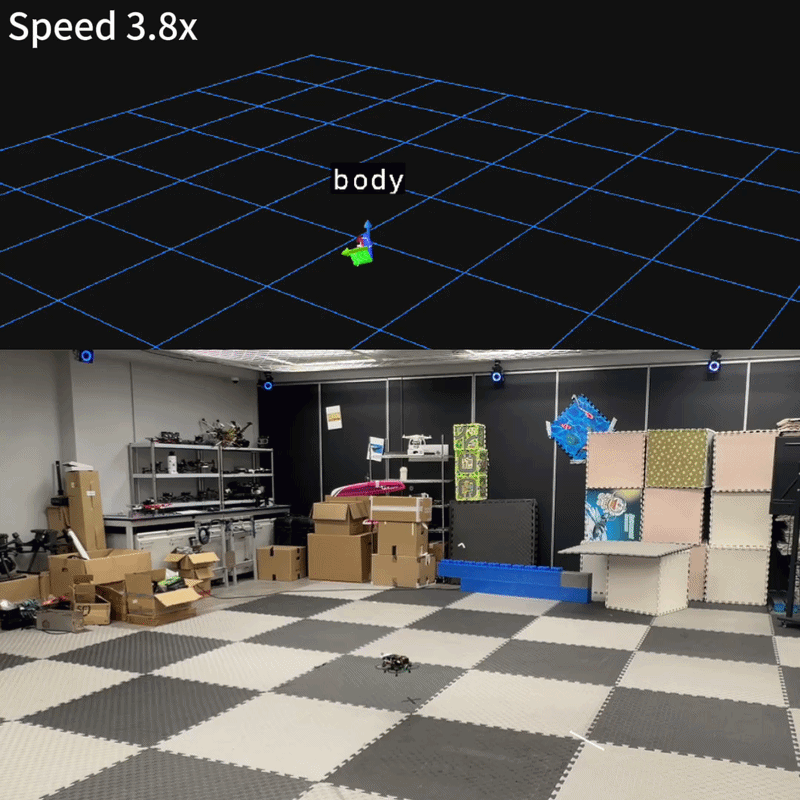

# 🚁 traj_test: UAV Trajectory Tracking & VIO Evaluation

[](https://pixi.sh)
[](http://wiki.ros.org/noetic)
[](https://michaelgrupp.github.io/evo/)
[](https://github.com/HKUST-Aerial-Robotics/VINS-Fusion)
[](https://www.cse.ust.hk/)

> Flight-test repo for two trajectory-tracking experiments on a quadrotor: mocap-based EKF tracking accuracy (project1) and VINS-Fusion / visual-EKF odometry drift (project2).

---

## 📖 About

This repo holds two ROS1 (Noetic) flight-test experiments, each with its own catkin workspace, flight bag, and evaluation pipeline built on [evo](https://michaelgrupp.github.io/evo/):

| Project | Role | Ground Truth |
|---|---|---|
| [`project1/`](project1/) | EKF trajectory tracking across 5 shapes (circle, cosine, donut, figure-eight variants) | Motion capture |
| [`project2/`](project2/) | VINS-Fusion & visual-EKF odometry drift on a figure-eight flight | Planned reference path |

A single root-level [Pixi](https://pixi.sh) environment provides the shared visualisation (RViz) and evaluation (`evo`, `rosbags`, `numpy`) tooling for both projects — each project's catkin workspace still builds the normal ROS way.

---

## 📁 Project Structure

```
traj_test/
├── pixi.toml / pixi.lock     # shared viz + eval env (RViz, evo, rosbags, numpy)
├── rviz.rviz                 # shared RViz config
├── project1/
│   ├── Report.md
│   ├── velocity_tracking_error.py
│   ├── bag/                  # 5 flight bags (circle, cos, donut, eight variants)
│   ├── results/              # APE/RPE plots & tables (evo output)
│   ├── fig/                  # trajectory GIFs
│   ├── videos/                # flight recordings (MP4)
│   └── uav_ws/                # catkin workspace (px4ctrl, traj_generator, RI_Mocap, ...)
└── project2/
    ├── Report.md
    ├── analyze_bag.py
    ├── bag/                  # record.bag (figure-eight flight)
    ├── results/              # analysis CSV + component/trajectory plots
    ├── fig/                  # trajectory GIF
    ├── videos/                # flight recordings (MP4)
    ├── uav_vins_local_ws/    # catkin workspace — VINS-Fusion variant
    └── uav_ws_ekf/           # catkin workspace — visual-EKF variant
```

---

## 🚀 Quick Start

**1. Install [Pixi](https://pixi.sh) (one-time):**

```bash
curl -fsSL https://pixi.sh/install.sh | bash
```

**2. Install the shared environment:**

```bash
pixi install
```

**3. Run the tasks:**

```bash
pixi run rviz          # launch RViz with the shared rviz.rviz config
pixi run topic         # list ROS1 topics (rostopic list)
pixi run analyze-p1    # project1: velocity_tracking_error.py
pixi run analyze-p2    # project2: analyze_bag.py
```

👉 For the `evo` APE/RPE command reference and ROS networking setup (Jetson/laptop), see below and [project1/Report.md](project1/Report.md) / [project2/Report.md](project2/Report.md).

---

## 🎬 Demo

| project1 — figure-eight tracking | project2 — VINS-Fusion flight |
|:---:|:---:|
|  |  |

---

## Setup

ROS networking (Jetson ↔ laptop), pixi activation env vars in `pixi.toml`:

```toml
[activation.env]
ROS_MASTER_URI = "http://<JETSON_IP>:11311"   # e.g. http://192.168.0.54:11311
ROS_IP = "<LAPTOP_IP>"                        # e.g. 192.168.0.153
```

---

## Trajectory Evaluation (evo)

Reference: https://michaelgrupp.github.io/evo/

Run these commands from inside `project1/` (paths below — `bag/`, `results/` — are relative to that directory).

### Bag files

```bash
evo_ape bag bag/eight.bag /vrpn_client_node/G3/pose /ekf/cam_ekf_odom -p
```

**3D trajectory comparison:**
```bash
evo_traj bag bag/circle.bag /ekf/cam_ekf_odom \
    --ref /vrpn_client_node/G3/pose -p --plot_mode xyz
```

**Summarise results to table:**
```bash
evo_res results/*.zip -p --save_table results/table.csv
```

**Relative Pose Error (RPE) — velocity-level proxy:**
```bash
evo_rpe bag bag/circle.bag /vrpn_client_node/G3/pose /ekf/cam_ekf_odom \
    -va --delta 1 --plot
```

---

## project2

VINS-Fusion / EKF visual-inertial odometry eval. Layout mirrors project1: `bag/` (record.bag), `results/` (analysis CSV + plots), `fig/` (GIF), `videos/` (MP4s). See [project2/Report.md](project2/Report.md) for the writeup.

```bash
pixi run analyze-p2     # run project2's bag analysis (project2/bag/record.bag -> project2/results/)
```

---

## 👥 Authors

**HKUST ELEC5660 Introduction to Aerial Robotics — Group 3**

| Name | GitHub |
|---|---|
| Borong Xu | [@boring180](https://github.com/boring180) |
| Yi Zhang | [@zhangone-smile](https://github.com/zhangone-smile) |
| Wong Wei Ming | [@Alvin0523](https://github.com/Alvin0523) |
