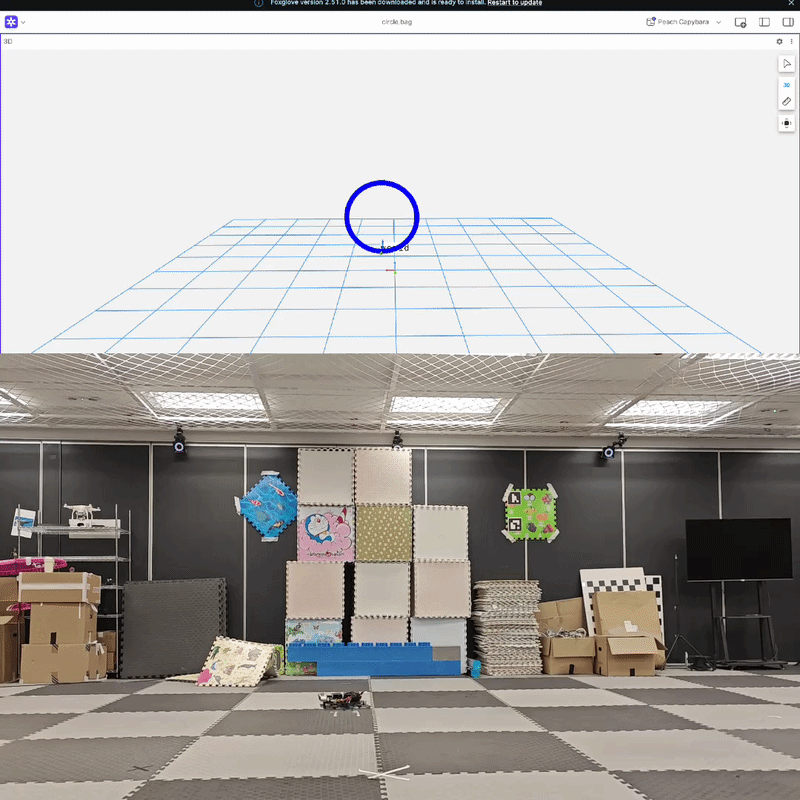
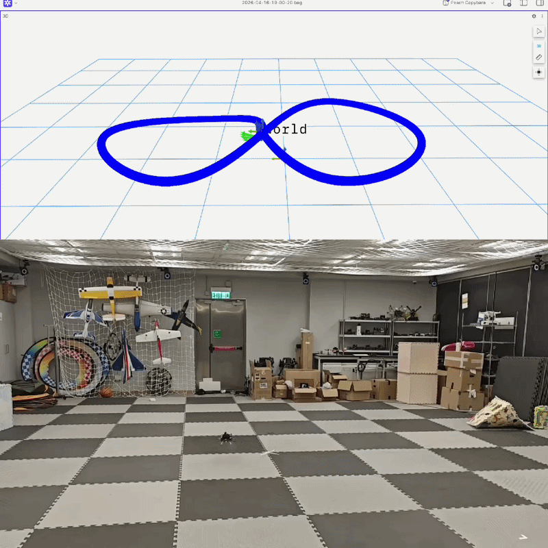
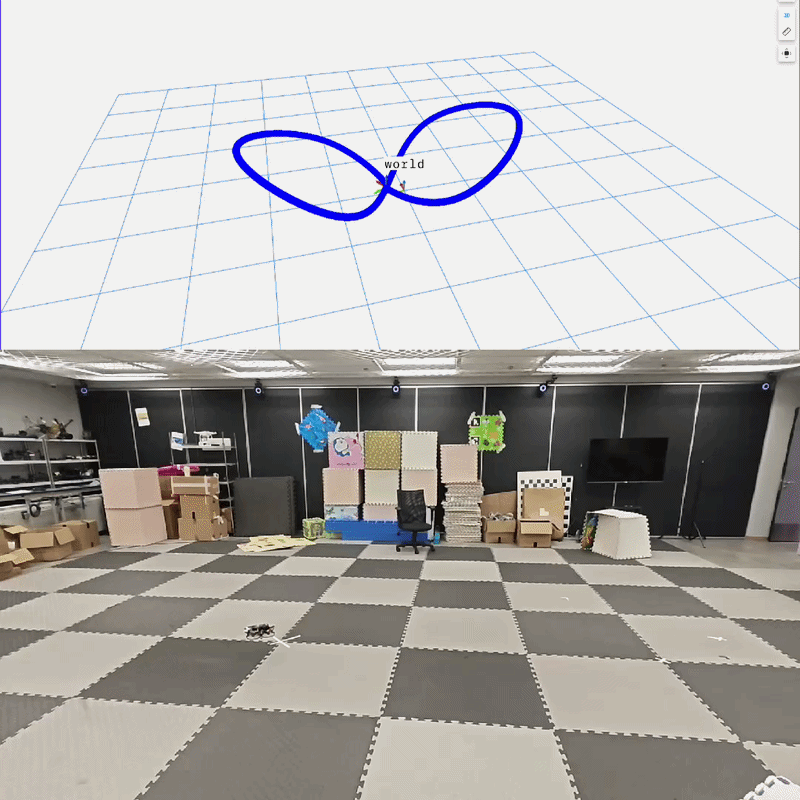
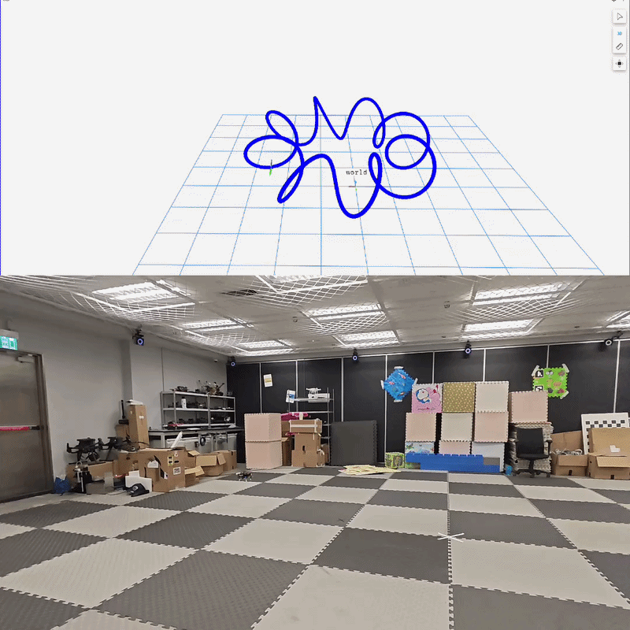

# ELEC 5660 Project 1 Phase 4 Report

*Autonomous Flight with Mocap: Flight Data Analysis Report*

## Group Information

- **Group Number:** Group 3
- **Group Members:** WONG, Wei Ming; XU, Borong; ZHANG, Yi
- **Project Name:** `Group3-Proj1Phase4`

## 1. Trajectory Design

| Trajectory | Shape Description | Observed Performance | GIF Placeholder |
|---|---|---|---|
| Circle | A circular trajectory on the same horizontal plane. | The motion is smooth and repeatable. The trajectory shows the best local motion consistency, although its global position RMSE is not the smallest. |  |
| Standard Eight(Provided) | A symmetric figure-eight trajectory on the same horizontal plane. | This trajectory achieves the best global tracking accuracy among all tested trajectories, with the smallest position RMSE and a low maximum position error. |  |
| Curved Eight | A modified figure-eight trajectory with curved transitions and nonuniform curvature on the horizontal plane. | The overall position error remains low, but the local motion error is clearly larger than that of the standard eight, indicating that the curved transitions are harder to track consistently. |  |
| Cosine Wave | A portion of a cosine wave in the same vertical plane. | The drone remains stable and controllable, but the vertical motion introduces more tracking difficulty than the planar standard eight trajectory. |  |
| Donut | A torus-like 3D periodic trajectory consisting of a primary circular motion combined with secondary oscillatory motion. | This is the most challenging trajectory overall. The drone needs several seconds after entering API flight mode to wait for the trajectory optimization to complete, and the trajectory produces the largest peak errors. |  |

## 2. Flight Data and Quantitative Results

We evaluate the flight data using **Absolute Pose Error (APE)** and **Relative Pose Error (RPE)**.  
APE measures the global position tracking accuracy with respect to the motion-capture ground truth.  
RPE measures the consistency of local frame-to-frame motion and is used here as a proxy for velocity-level tracking performance.

| Trajectory | Position RMSE (APE, m) | Max Position Error (m) | Local Motion RMSE (RPE, m) | Peak Local Motion Error (m) | Comment |
|---|---:|---:|---:|---:|---|
| Circle | 0.000765 | 0.002206 | 0.000023 | 0.000187 | Best local consistency, but not the smallest global position error. |
| Standard Eight | 0.000378 | 0.001243 | 0.000024 | 0.000544 | Best global accuracy overall. |
| Curved Eight | 0.000469 | 0.001288 | 0.000091 | 0.001075 | Good global alignment, but noticeably larger local motion error. |
| Cosine Wave | 0.000519 | 0.002158 | 0.000035 | 0.000298 | Moderate error; vertical motion increases difficulty. |
| Donut | 0.000548 | 0.004734 | 0.000107 | 0.001960 | Most difficult trajectory; largest peak global and local errors. |

### Velocity Tracking Error Analysis

We additionally evaluate velocity tracking error using the linear velocity components from the odometry topics. The RMSE is computed on the velocity norm.

| Trajectory | Velocity RMSE (m/s) | Mean Velocity Error (m/s) | 95% Error (m/s) | Max Velocity Error (m/s) |
|---|---:|---:|---:|---:|
| Circle | 0.173 | 0.154 | 0.293 | 0.603 |
| Standard Eight | 0.341 | 0.266 | 0.633 | 1.751 |
| Curved Eight | 0.164 | 0.149 | 0.265 | 0.561 |
| Cosine Wave | 0.222 | 0.183 | 0.405 | 1.371 |
| Donut | 0.373 | 0.239 | 0.786 | 2.736 |

## 3. Analysis and Discussion

The results show that trajectory complexity has a direct impact on tracking performance. Among all tested trajectories, the **standard eight** achieves the best global tracking accuracy, with the smallest APE RMSE (**0.000378 m**) and a relatively low maximum position error (**0.001243 m**). This suggests that a symmetric planar trajectory is easier for the estimator and controller to follow accurately over the entire flight.

The **circle** trajectory has the smallest local motion error, with an RPE RMSE of only **0.000023 m**, which indicates highly consistent frame-to-frame motion estimation. However, its APE RMSE (**0.000765 m**) is the largest among the five tested trajectories. This means that although the local motion is tracked very smoothly, a larger global bias or accumulated deviation remains over the full trajectory.

The **curved eight** and **cosine wave** occupy the middle range of difficulty. The curved eight maintains a relatively small APE RMSE (**0.000469 m**), but its RPE RMSE (**0.000091 m**) is much larger than that of the standard eight. This indicates that the estimator can still align well globally, while local tracking becomes less consistent when the curvature changes more aggressively. The cosine wave shows moderate APE and RPE values, which is reasonable because the additional vertical motion increases the tracking burden compared with purely planar motion.

The **donut** trajectory is the most challenging overall. It has the largest maximum position error (**0.004734 m**), the largest RPE RMSE (**0.000107 m**), and the largest peak local motion error (**0.001960 m**). This is consistent with the trajectory design: the donut combines horizontal circular motion with additional oscillatory motion in three dimensions, so both the controller and estimator must handle stronger nonlinearity and more complex motion coupling.

Overall, the data suggest that simple and symmetric planar trajectories are tracked most accurately, while trajectories with stronger three-dimensional coupling or rapidly changing curvature lead to larger local and global errors.

## 4. Conclusion

This report evaluates five flight trajectories using motion-capture ground truth and EKF-based odometry. The standard eight provides the best global tracking accuracy, while the circle provides the best local motion consistency. The donut trajectory is the most difficult to track and produces the largest peak errors, showing that tracking performance degrades as trajectory complexity and three-dimensional coupling increase.