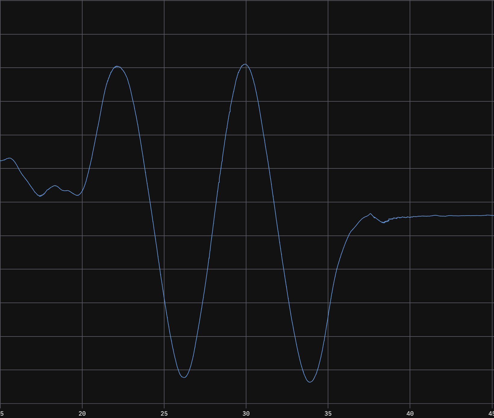
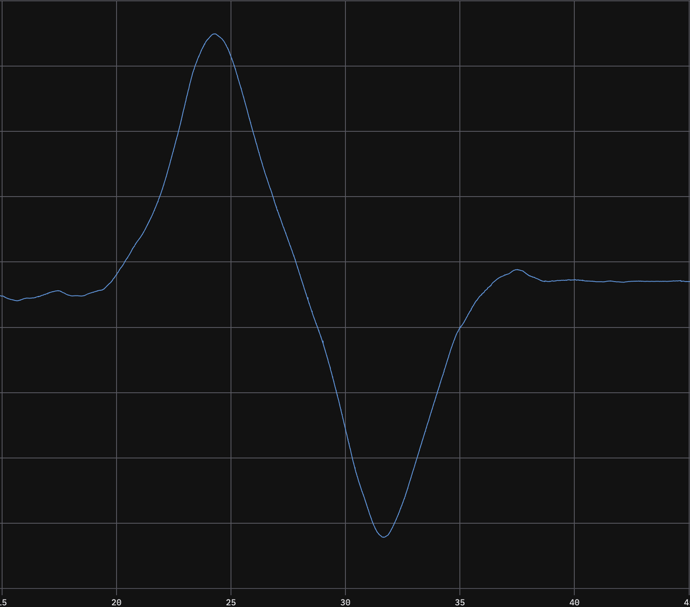
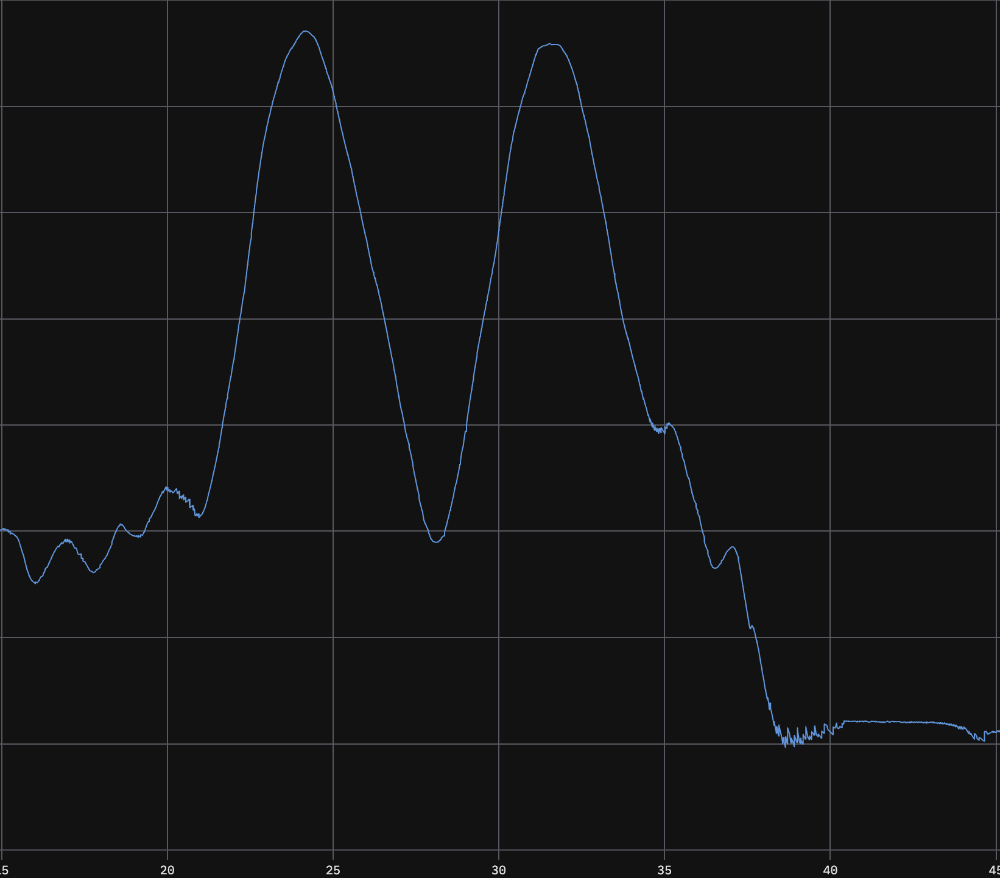
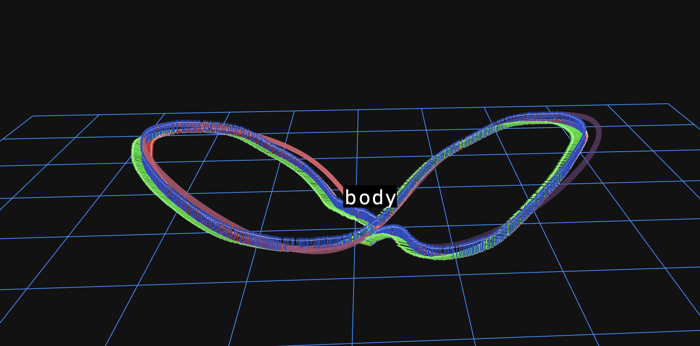

# ELEC 5660 Project 2 Report

*Autonomous Flight with VINS-Fusion Odometry: Flight Data Analysis Report*

## Group Information

- **Group Number:** Group 3
- **Group Members:** WONG, Wei Ming; XU, Borong; ZHANG, Yi
- **Project Name:** `Group3-Proj2`

## 1. Trajectory Description

The flight test uses a **figure-eight** trajectory to evaluate VINS-Fusion-based odometry performance. Unlike Project 1 where ground truth came from a motion capture system, this project relies solely on VINS-Fusion running on board the drone.

VINS-Fusion is a multi-sensor state estimation framework that fuses visual odometry (VO) from a stereo camera pair with IMU measurements. We use it with the Realsense D455 camera in stereo-infra-red mode, with the following key parameters:

| Parameter | Value |
|---|---|
| Trajectory shape | Figure-eight |
| Odometry system | VINS-Fusion (stereo VO + IMU) |
| Camera | Intel Realsense D455 (stereo infra-red) |
| IMU topic | `/mavros/imu/data` |
| Image topics | `/camera/infra1/image_rect_raw`, `/camera/infra2/image_rect_raw` |
| Max feature points | 25 |
| Feature tracking frequency | 15 Hz |
| IMU accelerometer noise | 0.1 |
| IMU gyroscope noise | 0.015 |
| Gravity magnitude | 9.805 m/s² |
| Time offset estimation | Enabled |

VINS-Fusion configuration (`uav_vins_adapter/config/vins_realsense_stereo_imu.yaml`):

```yaml
# Feature tracker
max_cnt: 25
min_dist: 50
freq: 15

# Optimization
max_solver_time: 0.04
max_num_iterations: 8
keyframe_parallax: 10.0

# IMU noise
acc_n: 0.1
acc_w: 0.0005
gyr_n: 0.015
gyr_w: 0.0002
g_norm: 9.805

# Time offset
estimate_td: 1
td: 0.0
```

The odometry output (`/ekf/ekf_odom`) begins publishing after the trajectory is displayed, with the flight data recorded for analysis.

### Challenges Encountered with VINS-Fusion

**1. Delayed output at startup**: VINS-Fusion can experience output delays exceeding 1 minute when first initialized. This was significantly improved by reducing the number of feature points tracked (`max_cnt` reduced from default to 25), which decreases processing load and initialization time.

**2. Height accuracy issues**: We attempted to augment the EKF with visual odometry and IMU fusion, but found that height estimation was consistently inaccurate. We tried additionally fusing height readings from the drone's ground distance sensor, but this did not improve the height accuracy. The ground distance sensor measurements were noisy and introduced additional error rather than correction.

**3. Divergence during takeoff and landing**: VINS-Fusion sometimes diverges during takeoff and landing phases. This is attributed to two factors: (a) the bouncing motion of the drone during these phases creates rapid camera motion that violates the visual tracking assumptions, and (b) the ground surface offers minimal "good" feature points — the floor is typically textureless, so neither visual odometry nor IMU can maintain accurate state estimation during ground contact.

Future improvements include accepting more feature points with slightly lower quality thresholds so that ground features can be captured, and filtering outlier IMU messages that occur during rapid movements to prevent filter divergence.

| Parameter | Value |
|---|---|
| Trajectory shape | Figure-eight |
| Odometry path length | 14.926 m |
| Number of odometry poses | 4430 |
| Flight duration | 32.15 s |


### Odometry Trajectory Plots

The following plots show the odometry position over time along each axis and the 3D trajectory comparison:

**X-axis position over time:**


**Y-axis position over time:**


**Z-axis position over time:**


**3D trajectory: VINS odometry vs reference path:**


## 2. Flight Data and Quantitative Results

We evaluate the flight data using **Absolute Pose Error (APE)** and **Relative Pose Error (RPE)**, following the same methodology as Project 1.

APE measures the distance from each odometry pose to the nearest reference waypoint on the planned path. RPE measures the consistency of local frame-to-frame motion and serves as a proxy for velocity-level tracking performance.

### 2.1 Position Tracking Error (APE)

| Metric | Value |
|---|---:|
| Position RMSE (APE) | 0.142 m |
| Mean Position Error | 0.125 m |
| Max Position Error | 0.301 m |
| 95th Percentile Error | 0.248 m |

### 2.2 Local Motion Error (RPE)

| Metric | Value |
|---|---:|
| RPE RMSE | 0.021 m |
| Mean RPE | 0.020 m |
| Max RPE | 0.037 m |
| 95th Percentile RPE | 0.031 m |

### 2.3 Velocity Tracking Error Analysis

| Metric | Value |
|---|---:|
| Velocity RMSE [vx, vy, vz] | [0.162, 0.153, 0.226] m/s |
| Velocity RMSE (norm) | 0.317 m/s |
| Mean Velocity Error (norm) | 0.083 m/s |
| 95th Percentile Velocity Error (norm) | 0.214 m/s |

## 3. Analysis and Discussion

### Position Tracking

The **APE RMSE of 14.2 cm** reflects accumulated drift in the VINS-Fusion estimator. Without external correction from motion capture, scale and pose drift accumulate over the flight. The odometry path length (14.926 m) exceeds the reference path length (12.902 m) by 16%, indicating noticeable scale drift in addition to position drift.

### Local Motion Consistency

The **RPE RMSE of 2.1 cm** demonstrates good frame-to-frame tracking consistency. This indicates that VINS-Fusion produces smooth state updates — critical for controller stability, where each individual measurement must be reliable even if global drift accumulates over time.

### Velocity Validation

The **95th-percentile velocity error of 0.214 m/s** confirms that the odometry twist velocity is generally consistent with velocity computed by differentiating position. The Z-velocity component shows the largest RMSE (0.226 m/s), likely due to vertical vibration and the height estimation challenges mentioned earlier.

## 4. Conclusion

This report evaluates VINS-Fusion-based odometry flight data against a planned figure-eight reference trajectory. The **APE RMSE of 14.2 cm** and **RPE RMSE of 2.1 cm** confirm that the drone tracks the planned path with reasonable local accuracy. The **velocity 95th-percentile error of 0.214 m/s** validates internal consistency of the estimator. Key challenges included VINS initialization delay (resolved by reducing feature points), height inaccuracy during ground proximity, and divergence during takeoff/landing phases due to insufficient visual features on the ground surface. Future work should focus on improving height estimation and robustness during transition phases.